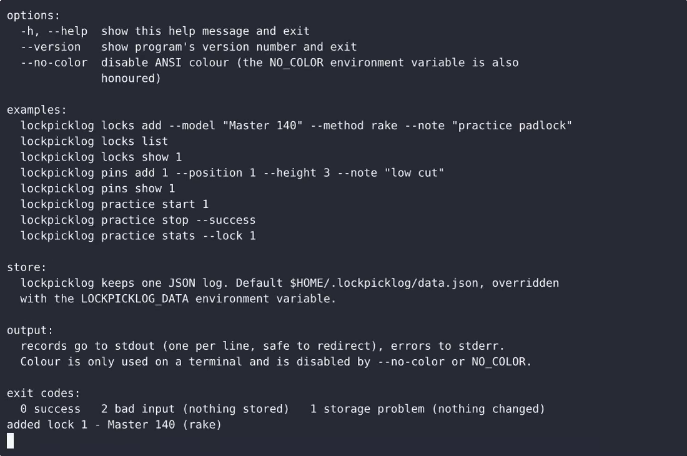
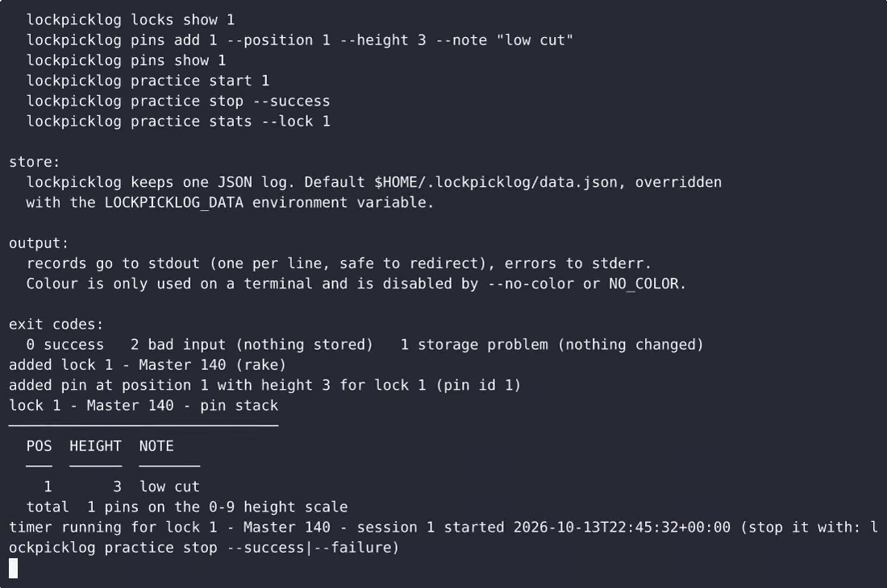

# LockpickLog — complete Full-stack app command-line tool example app

Most open-source command-line tool projects ship a skeleton. **LockpickLog** ships the whole thing: production-ready Full-stack app source, seeded demo data, and a LockpickLog install script that runs in minutes. A single-file, standard-library-only Python command-line tool that logs the locks you work on (model plus picking method), records pin tumbler sequence notes per lock, and times practice attempts to report a success r…. Apache-2.0-licensed — [remix LockpickLog on cenius.ai](https://cenius.ai/marketplace/p/lockpicklog?ref=gh&utm_campaign=lockpicklog-webapp) for your own branded build.


[](LICENSE)  [](https://cenius.ai)

[](https://cenius.ai/marketplace/p/lockpicklog?ref=gh&utm_campaign=lockpicklog-webapp)

> **▶ [Open & edit in cenius.ai](https://cenius.ai/marketplace/p/lockpicklog?ref=gh&utm_campaign=lockpicklog-webapp)** — one click to an editable workspace: describe changes in plain English, get an instant preview, one-click deploy and host. Modifications made on the platform come with full rebrand & relicense rights.

_Local clone? See [Quick start](#quick-start) below. cenius.ai is the zero-setup path._

## Demo


▶ **[See it in action](https://cenius.ai/marketplace/p/lockpicklog?ref=gh&utm_campaign=lockpicklog-webapp)** — full demo on the project page · [MP4](.github/media/demo.mp4)

## Screenshots

 

## Usage guide

Task-by-task recipes. Every command is `python3 lockpicklog.py <command>`;
substitute `python3` for whichever interpreter you use. Records go to stdout,
errors to stderr, and nothing is written when a command fails.

Set `LOCKPICKLOG_DATA=/path/to/log.json` on any command to use a log other than
`$HOME/.lockpicklog/data.json`.

### Log a lock you own or borrowed

```bash
python3 lockpicklog.py locks add --model "Master 140" --method rake --note "cheap practice padlock"
## added lock 1 - Master 140 (rake)
```

`--model` and `--method` are required and must not be blank. `--note` is
optional and free text - put the tension you needed, where it came from, how
worn it is, anything you would forget.

Browse what you have:

```bash
python3 lockpicklog.py locks list      # newest first, with pin counts
python3 lockpicklog.py locks show 1    # every stored field
```

On a brand-new log `locks list` prints
`no locks logged yet - add one with: lockpicklog locks add --model <text> --method <text>`
and exits 0.

### Note a pin tumbler sequence

Add the stack one pin at a time. `--position` counts from the front of the lock
starting at 1; `--height` is the pin's length on the 0-9 scale.

```bash
python3 lockpicklog.py pins add 1 --position 1 --height 3 --note "low cut"
python3 lockpicklog.py pins add 1 --position 2 --height 7
python3 lockpicklog.py pins add 1 --position 3 --height 4 --note "spool, holds a false set"
python3 lockpicklog.py pins show 1
```

_Full guide: [`USAGE.md`](USAGE.md)_

## Features

- Lock model and picking method log
- Pin tumbler sequence notes
- Practice timer and success rate

## Quick start

```bash
./install.sh   # installs dependencies + seeds demo data
```

See [`INSTALL.md`](INSTALL.md) for full setup and usage instructions.

## Architecture

`install.sh` provisions dependencies and seeds demo data so the app starts with something real to explore. The Full-stack app codebase (20 files) is self-contained — no external services needed to evaluate it. Top-level layout: `demo/`, `tests/`. Step-by-step setup guide: [`INSTALL.md`](INSTALL.md).

## FAQ

### How do I run LockpickLog on my own server?

It runs entirely on your own machine. Clone, run `./install.sh`, and follow [`INSTALL.md`](INSTALL.md) — the whole stack is in this repo, no external dependencies required.

### Can I rebrand or white-label LockpickLog?

Rebranding is straightforward under the MIT license — change what you want in the source. Or [open it on cenius.ai](https://cenius.ai/marketplace/p/lockpicklog?ref=gh&utm_campaign=lockpicklog-webapp): the platform handles the changes and grants full rebrand rights on the result.

### What technologies are in LockpickLog's stack?

Powered by Full-stack app. This repo is the real thing — full source, seed data, and all — ready to clone and start up. Highlights include practice timer and success rate.

### What if I want to add features to LockpickLog without coding?

The easiest route: [visit the project on cenius.ai](https://cenius.ai/marketplace/p/lockpicklog?ref=gh&utm_campaign=lockpicklog-webapp), tell the platform what to change, and collect the updated build. No source-editing needed.

### Can I use LockpickLog in a commercial project?

Yes. The code is Apache-2.0-licensed — use it, modify it, and ship it commercially. See [LICENSE](LICENSE).

## License & rebranding

Released under the [Apache License 2.0](LICENSE) (© 2026 Cenius AI) — free for personal and commercial use. The Cenius name/logo are trademarks (see NOTICE).

**Need a customized version?** [Remix this app on cenius.ai](https://cenius.ai/marketplace/p/lockpicklog?ref=gh&utm_campaign=lockpicklog-webapp) — modifications made on the platform come with **full rebrand & relicense rights** over your derivative.

## Built with cenius.ai

This entire application — code, design, seeded demo data — was generated on **[cenius.ai](https://cenius.ai)** from a plain-English description.

- 🚀 [Build your own app on cenius.ai](https://cenius.ai)
- 🎛️ [Remix LockpickLog on the marketplace](https://cenius.ai/marketplace/p/lockpicklog?ref=gh&utm_campaign=lockpicklog-webapp) — open it in a workspace, prompt for changes, and ship your own version.

More open-source apps: [the Cenius-ai catalog](https://github.com/Cenius-ai) · [showcase index](https://github.com/Cenius-ai/showcase)
